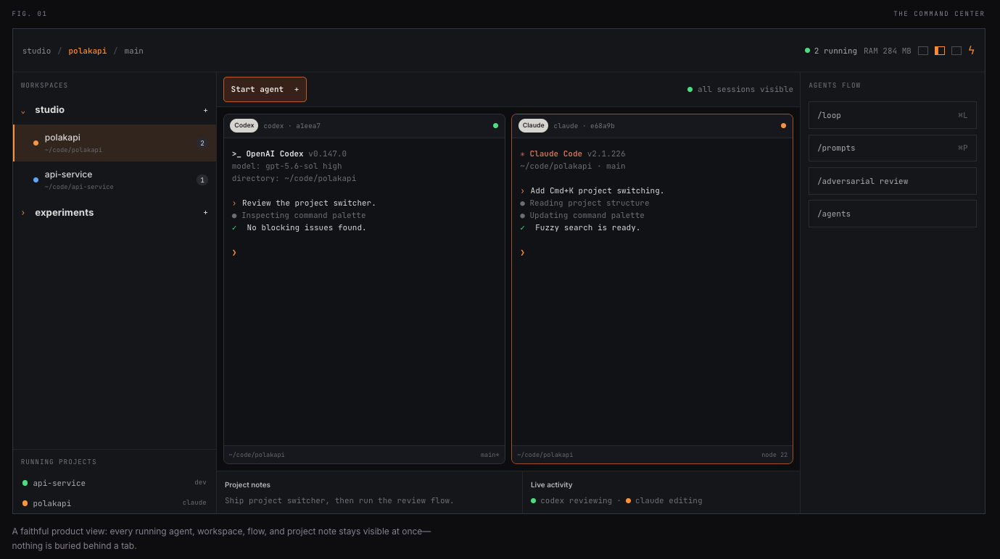

# polakapi

polakapi is a cross-platform desktop workspace for running AI coding agents and terminal sessions side by side.



## Highlights

- Run multiple terminal-based coding agents in a single window.
- Organize repositories and sessions into persistent workspaces.
- Manage active processes, notes, prompts, and agent workflows from one interface.
- Use Claude Code, Codex, OpenCode, or any other terminal-based tool.
- Operate polakapi from an agent tab, or from Telegram through an optional bot limited to allowed users.

## Install

Download the desktop package from [GitHub Releases](https://github.com/rafaelje/polakapi/releases). Building from source is not required.

### Script installers

The commands below require a release containing `install.sh`, `install.ps1`, and `manifest.tsv`. They will not work against older releases that lack these assets. This feature must be published before the public commands are available.

**macOS and Linux:**

```sh
curl -fsSL https://github.com/rafaelje/polakapi/releases/latest/download/install.sh | sh
```

**Windows PowerShell:**

```powershell
Invoke-WebRequest https://github.com/rafaelje/polakapi/releases/latest/download/install.ps1 -OutFile install.ps1
Get-Content .\install.ps1
.\install.ps1
```

For shell users who prefer to inspect the installer first:

```sh
curl -fsSL https://github.com/rafaelje/polakapi/releases/latest/download/install.sh -o install.sh
less install.sh
sh install.sh
```

Installers verify package checksums, install for the current user, and leave settings and workspaces intact. A checksum detects mismatched release bytes; it does not replace trust in the release publisher or Apple's notarization. macOS builds are ad-hoc signed, so macOS may require approval in Privacy & Security. Do not disable OS security protections. If Windows policy blocks the script, use the release's `.exe` installer instead.

Rerun the installer to update, or select a release with `--version X.Y.Z` (`-Version X.Y.Z` in PowerShell). Close polakapi first. See [macOS/Linux installation](docs/install-posix.md) and [Windows installation](docs/install-windows.md) for destinations, uninstall instructions, platform limits, and Git Bash usage. AI coding CLIs are installed separately.

Git Bash verifies the PowerShell script before launching it with `RemoteSigned` for that process and its child sessions only. This can override local script restrictions, but does not change saved policies or override organization-enforced Group Policy. Direct PowerShell invocation retains the existing policy.

### Installer development

Run `pnpm test:installers` for public-command fixture tests. Native platform checks are required in addition to fixtures; a macOS test does not establish Windows/Linux compatibility.

Prepare a release directory from existing bundles:

```sh
node scripts/prepare-installer-release.mjs --assets /path/to/bundles --output /path/to/new-release --version X.Y.Z
```

The output includes the installers, manifest, version marker, and `SHA256SUMS`. Existing output directories are never overwritten. For a local single-platform test only, add `--allow-partial`. Serve that directory on loopback and run `sh scripts/install.sh --source http://127.0.0.1:PORT --install-dir /path/to/isolated-install`. Never serve private files or expose the server on a public interface.

For a packaged macOS development test, use a separate bundle identifier (`com.rafaelje.polakapi.installtest`) and isolated `HOME`, `TMPDIR`, and working directory when launching the installed executable. Do not run the normal application against real user data as a smoke test. A locally produced DMG does not verify fresh-download Gatekeeper behavior.

The release workflow prepares all assets before publishing a draft, and refuses to replace an existing version. Failed draft publication needs maintainer inspection; rerunning does not overwrite release bytes.

## Develop

### Requirements

- Git
- Node.js 22.11 or later in the Node.js 22 LTS line
- pnpm 11.8
- Rust stable
- [Tauri prerequisites](https://v2.tauri.app/start/prerequisites/) for your operating system

### Windows Setup

Native Windows development requires the following components:

1. Install [Microsoft C++ Build Tools](https://visualstudio.microsoft.com/visual-cpp-build-tools/). Select the **Desktop development with C++** workload and keep a Windows SDK selected.
2. Install the [Microsoft Edge WebView2 Evergreen Runtime](https://developer.microsoft.com/en-us/microsoft-edge/webview2/) if it is not already present. It is included with current Windows 10 and Windows 11 installations.
3. Install Rust with [rustup](https://rustup.rs/), select the MSVC host toolchain, and restart PowerShell.
4. Install Node.js 22 and enable the repository's pnpm version with Corepack.

Verify the toolchain from a new PowerShell window:

```powershell
rustup default stable-msvc
rustup component add rustfmt clippy
corepack enable
corepack prepare pnpm@11.8.0 --activate
```

After cloning the repository and installing its dependencies, the Tauri environment report should show WebView2, MSVC, `rustc`, and Cargo as available:

```powershell
pnpm tauri info
```

### Run Locally

On Windows, use PowerShell:

```powershell
git clone https://github.com/rafaelje/polakapi.git
Set-Location polakapi
pnpm install --frozen-lockfile
pnpm tauri info
pnpm tauri dev
```

On macOS or Linux:

```sh
git clone https://github.com/rafaelje/polakapi.git
cd polakapi
pnpm install --frozen-lockfile
pnpm tauri dev
```

AI coding CLIs are optional and must be installed separately and available on your `PATH`.

### Terminal Locale

New terminal sessions default to a UTF-8 locale when `LANG` is unset or empty:
`en_US.UTF-8` on macOS and `C.UTF-8` on Linux. Existing `LANG` and `LC_*`
settings are preserved, and shell startup files can override the default.
Windows locale settings are unchanged.

If CocoaPods reports a UTF-8 encoding error, open a new terminal after updating
polakapi and run `locale charmap` to confirm it reports `UTF-8`. Existing
terminal sessions keep their original environment. If a new terminal still
reports another encoding, check your explicit `LANG`, `LC_ALL`, and `LC_CTYPE`
settings and shell startup files. Once the locale is corrected, rerun
`pod install` in the project's `ios` directory before retrying the build.

### Copy Terminal Text

Each submitted shell command and its output form a copyable block. Hover over
that block to reveal its **⋮** button on the right, or right-click the block:

- **Copy** copies the command and output together, without the shell prompt.
  If output is unavailable, it copies the current selection instead, or is
  disabled when nothing is selected.
- **Copy command** copies only that block's submitted command.
- **Copy output** copies only that block's rendered output.
- **Copy selection** is also available when text is selected.
- **Paste** pastes the clipboard into the terminal.

Older blocks remain independently copyable while their start is retained in
scrollback (up to 200 blocks). If a width change reflows a shared output/prompt
line, its affected block menus are withheld rather than targeting the wrong
command; selection Copy remains available. An empty prompt has no block button. Right-clicking
outside a block keeps the standard selection Copy/Paste menu. This also works
in the bottom **Shell** tab; no permanent header copy button is shown.

On macOS, **Shift + Cmd + C** copies the hovered block's command and
**Option + Shift + Cmd + C** copies its output; without a hovered block they use
the latest block. On Linux and Windows, use **Ctrl + Alt + C** and
**Ctrl + Alt + Shift + C**. **Shift + F10** opens the block menu for the selected
text's block, or the latest block when nothing is selected. Selection copying
stays **Cmd + C** / **Ctrl + Shift + C**; **Ctrl + C** still interrupts the process.

Blocks require the built-in Bash or Zsh shell integration and are captured in
new shell sessions. Running commands copy output received so far. Full-screen
applications, evicted output, or resizing during a command make that command's
output unavailable; use selection Copy instead. Completed output is retained
with its block. Copied output is rendered plain text, not ANSI formatting or a
byte-for-byte process log.

Commands in a pane restored from another window's saved screen have no tracked
block. Their block menu is unavailable; use selection Copy instead. Commands
run after the handoff are tracked normally.

### Search Terminal Output

Press **Cmd + F** on macOS or **Ctrl + F** on Linux and Windows while a terminal
pane is focused. The search bar covers only that pane's visible output and all
retained scrollback (up to 5,000 history lines).

Use **Enter** / **Shift + Enter**, or the arrow buttons, to move between matches.
Navigation wraps around. The bar shows the current match and total, with toggles
for regular expressions, case sensitivity, and whole-word matching. Matches are
blue; the active match is orange with a border.

**Escape** or the close button returns focus to the terminal. Switching panes
closes search; reopening it recalls that pane's query and options until the pane
is closed or respawned. Output continues arriving during search without forcing
the view to the bottom when you are reading history. Closing search keeps the
current view.

Search uses the active screen buffer, so full-screen programs expose their current
screen rather than the shell's hidden scrollback. For Codex conversation history,
start Codex with `--no-alt-screen` (for example, `cy --no-alt-screen` if you use a
`cy` alias). This keeps its output in the terminal's searchable scrollback.
Empty regex matches are skipped.
Invalid or overly slow expressions show an error; simplify the query to retry.

### Split Terminals

In the main project workspace on macOS, **Cmd + D** splits the focused terminal
into equal left/right panes. **Cmd + Shift + D** splits it into equal top/bottom
panes, opening the new terminal below. Further splits divide the focused pane
without rearranging its neighbors. Drag a divider to resize the panes.

Use **Cmd + Option + arrow keys** on macOS to focus the nearest terminal in that
direction. Focus stays in place when there is no terminal in that direction.
**Cmd + Shift + arrow keys** also works; on Windows and Linux, use
**Ctrl + Shift + arrow keys**.

**View → Toggle Menu Bar** hides or shows the menu bar: **Cmd + Shift + M** on
macOS auto-hides the system menu bar and Dock until the pointer reaches the
screen edge, and **Ctrl + Shift + M** on Windows and Linux hides the in-window
menu bar. The choice persists across restarts.

### Build on Windows

Build the NSIS installer from PowerShell:

```powershell
pnpm tauri build --bundles nsis
Get-ChildItem .\src-tauri\target\release\bundle\nsis\*-setup.exe
```

Using an explicit NSIS target avoids the optional MSI toolchain. Running `pnpm tauri build` without `--bundles` follows `tauri.conf.json` and builds all Windows bundle targets. MSI builds may require enabling the Windows VBSCRIPT optional feature, as described in the [Tauri Windows installer guide](https://v2.tauri.app/distribute/windows-installer/).

Run the complete local quality gate before contributing:

```powershell
pnpm run check
```

### Windows Troubleshooting

- Run `pnpm tauri info` first; it reports missing WebView2, MSVC, Rust, Node.js, and package-manager components.
- If `rustc` or Cargo is not found after installing rustup, open a new PowerShell window and run `rustup default stable-msvc`.
- If compilation cannot find `cl.exe` or `link.exe`, modify the Visual Studio Build Tools installation and add the **Desktop development with C++** workload, then restart PowerShell.
- If WebView2 is missing, install the Evergreen Runtime and restart the app.
- If `pnpm` is unavailable and Corepack is not installed, run `npm install --global pnpm@11.8.0`.
- Restart PowerShell and polakapi after installing or updating an AI coding CLI so the app receives the updated `PATH`.

## Contributing

See [CONTRIBUTING.md](CONTRIBUTING.md) for development and contribution guidelines. Security vulnerabilities should be reported according to [SECURITY.md](SECURITY.md).

## License

polakapi is available under the [MIT License](LICENSE).
